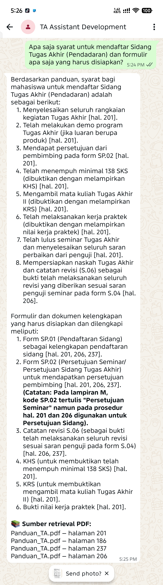
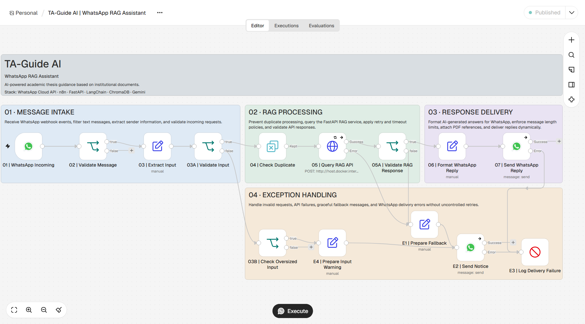

# Chatbot Panduan Tugas Akhir

Backend FastAPI menjalankan RAG secara lokal: PDF diekstrak sebagai Markdown dengan struktur heading, tabel, dan persamaan dipertahankan, lalu dikelompokkan lintas halaman berdasarkan heading dengan overlap. Embeddings multibahasa dibuat secara lokal, dan ChromaDB menyimpan indeks. Retrieval menggabungkan semantic search dengan BM25 lokal. Hanya pembuatan jawaban yang mengirim pertanyaan dan potongan konteks terpilih ke Gemini.

## Dokumentasi visual

### Contoh percakapan WhatsApp



### Workflow n8n



Gambar di atas ditampilkan langsung di beranda GitHub melalui README. Untuk menambahkan gambar dokumentasi lain, simpan file gambar di folder `dokumentasi/`, lalu tambahkan Markdown berikut ke README:

```markdown

```

## Menyiapkan backend (PowerShell)

```powershell
py -3.11 -m venv .venv
.\.venv\Scripts\Activate.ps1
python -m pip install --upgrade pip
pip install -r requirements.txt
Copy-Item .env.example .env
```

Isi `GEMINI_API_KEY` di `.env` dengan kunci dari Google AI Studio. Jangan bagikan atau commit file `.env`.

Letakkan tepat satu file PDF panduan TA di folder `knowledge_base/`. Folder tersebut disediakan di repositori, tetapi PDF tidak disertakan dan diabaikan oleh Git. Nama file bebas; ekstensi PDF tidak peka huruf besar/kecil. Jangan letakkan lebih dari satu PDF di folder itu. Untuk membuat atau memperbarui indeks:

```powershell
python ingest.py
```

Unduhan model embedding lokal hanya diperlukan saat indeks pertama kali dibuat. Lalu jalankan API:

```powershell
uvicorn app.main:app --host 0.0.0.0 --port 8000
```

Cek `http://localhost:8000/health` dan dokumentasi API di `http://localhost:8000/docs`. Endpoint `POST /ask` menerima `{"question":"..."}` dan mengembalikan jawaban, sumber file/halaman, serta cuplikan chunks yang dipakai untuk menjawab.

## Menjalankan UI Streamlit

Pastikan backend FastAPI sudah berjalan di port `8000`. Di terminal lain, aktifkan virtual environment lalu jalankan:

```powershell
.\.venv\Scripts\Activate.ps1
streamlit run app/streamlit_app.py
```

Buka `http://localhost:8501`. URL backend dapat diubah dari sidebar UI jika API berjalan di alamat lain. Pilih jawaban "Benar" atau "Salah" untuk menyimpan evaluasi secara lokal ke `feedback.jsonl` (file ini tidak dilacak Git). Nilai `API_BASE_URL` dapat diatur sebagai environment variable untuk mengubah alamat backend default.

Jalankan tes unit dengan `python -m unittest discover -s tests`.

## Menjalankan n8n

Docker Desktop dan WSL2 harus sudah berjalan. Dari folder proyek:

```powershell
docker compose up -d
```

Buka `http://localhost:5678` dan impor `n8n/workflows/chatbot-panduan-ta.json`. Workflow menggunakan `http://host.docker.internal:8000/ask`, yang menghubungkan container n8n ke FastAPI pada Windows. Pastikan API berjalan dengan `uvicorn app.main:app --host 0.0.0.0 --port 8000`.

### Uji dengan payload mock

Workflow tidak aktif secara default dan tidak menyertakan credential. Untuk memeriksa alur tanpa memanggil WhatsApp:

1. Pada node **WhatsApp Trigger**, gunakan data pin/mock dengan bentuk event hasil trigger berikut:

   ```json
   {
     "messages": [
       {
         "from": "6281234567890",
         "type": "text",
         "text": {
           "body": "Apa syarat seminar proposal?"
         }
       }
     ]
   }
   ```
2. Jalankan node normalisasi dan cek bahwa pengirim dan pertanyaan terbaca. Jalankan node **Tanya Backend RAG** untuk uji integrasi lokal; node ini memerlukan FastAPI aktif dan dapat menggunakan Gemini yang dikonfigurasi proyek.
3. Sebelum menjalankan workflow end-to-end, pasang credential n8n dan pilih **Phone Number ID** pada node kirim. Jangan menyalakan workflow untuk mengirim pesan jika belum siap memakai nomor uji Meta.

Pesan gambar, audio, lokasi, dan tipe non-teks lainnya dibalas dengan permintaan agar pertanyaan dikirim sebagai teks. Error backend/Gemini dikembalikan sebagai pesan gangguan singkat dan tidak membocorkan detail internal.

### Webhook HTTPS terbatas untuk WhatsApp

Webhook WhatsApp perlu URL HTTPS yang dapat diakses Meta. `n8n/Caddyfile` hanya meneruskan `GET`/`POST` untuk path trigger workflow pada hostname tunnel yang sedang aktif dan menolak path lain. Port editor n8n tetap terikat ke `127.0.0.1:5678`; tunnel diarahkan ke proxy, bukan langsung ke editor atau FastAPI.

Quick Tunnel tidak memerlukan token atau domain berbayar, tetapi URL `trycloudflare.com` berubah setiap kali tunnel dibuat ulang. Gunakan launcher PowerShell agar URL baru diterapkan otomatis ke Caddy dan n8n serta callback workflow didaftarkan ulang ke Meta:

```powershell
.\start-whatsapp-tunnel.ps1
```

Docker Desktop harus berjalan dan `cloudflared.exe` harus terpasang (launcher memakai executable Windows yang sudah ada, bukan menarik image tunnel baru). Launcher mengambil URL Quick Tunnel, memasang hostname dan ID trigger pada proxy, lalu mem-publish workflow agar callback Meta diperbarui.

Biarkan jendela PowerShell launcher tetap terbuka selama webhook digunakan; `Ctrl+C` menghentikan tunnel. Jalankan ulang setelah Docker/Windows dimulai ulang. Jika ID workflow atau ID webhook trigger berubah, berikan ID yang baru:

```powershell
.\start-whatsapp-tunnel.ps1 -WorkflowId ID_WORKFLOW -WebhookId ID_TRIGGER
```

Launcher tidak mengubah `.env` atau credential. Root URL publik tetap harus memberi `404`; hanya path webhook WhatsApp yang diteruskan. Editor tetap tersedia secara lokal di `http://localhost:5678`. Quick Tunnel cocok untuk development, bukan endpoint permanen.

### Setup Meta dan credential n8n

Langkah ini memerlukan akun/aset Meta Anda dan belum dilakukan:

1. Di Meta for Developers buat aplikasi business, tambahkan produk WhatsApp, lalu buka **WhatsApp > API Setup**. Gunakan nomor uji yang disediakan Meta dan daftarkan nomor penerima uji sesuai petunjuk di dashboard.
2. Di n8n, buat credential **WhatsApp Trigger OAuth2 API** dari **App ID** dan **App Secret** aplikasi Meta, lalu pilih credential itu di node trigger.
3. Buat credential **WhatsApp API** untuk node kirim menggunakan access token dan **WhatsApp Business Account ID** dari dashboard Meta. Pilih Phone Number ID pengirim pada node **Kirim Balasan WhatsApp**.
4. Setelah URL HTTPS tersedia, aktifkan/publish workflow. WhatsApp Trigger n8n mendaftarkan callback Meta saat workflow aktif; Meta hanya mengizinkan satu webhook aktif per aplikasi. Kirim pesan uji teks dari nomor penerima terdaftar.

Token hanya disimpan sebagai credential terenkripsi di n8n; App Secret tidak diperlukan di workflow. Jangan mengubah mode/izin akun Meta atau mengirim pesan berbayar tanpa meninjau dan mengonfirmasi langkah tersebut. End-to-end test belum dapat dijalankan tanpa akun dan credential Meta.

Jika Docker belum tersedia atau WSL gagal berjalan, aktifkan fitur Windows Subsystem for Linux dan Virtual Machine Platform, pastikan virtualisasi aktif di BIOS/UEFI, lalu jalankan `wsl --install --no-distribution` dari PowerShell Administrator dan restart Windows. Instal/jalankan Docker Desktop setelah itu. Langkah ini memerlukan tindakan manual/izin administrator. Backend dan endpoint `/docs` tetap dapat dijalankan tanpa Docker.
